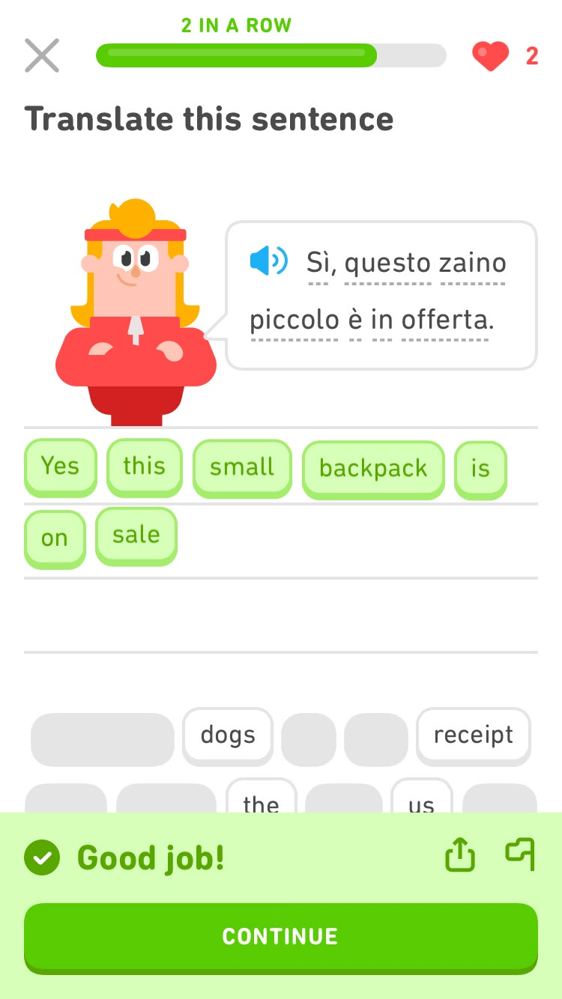

# ScholarET — Grade 12 Textbook Gamified Learning UI

A tactile, commercial-grade Grade 12 textbook gamified curriculum platform inspired by Duolingo's habit-forming mechanics, adapted for advanced STEM and secondary school curriculum (AP Calculus BC, Physics Mechanics, Organic Chemistry, and Macroeconomics).



## Core Architectural Pillars

### 1. Strict 60 · 30 · 10 Palette Hierarchy
- **`#F4E1D2` (Warm Almond, ~60%)**: Calming canvas background that reduces ocular fatigue during long textbook problem-solving sessions.
- **`#008080` (Ocean Teal, ~30%)**: Brand buttons, progress gauges, active curriculum nodes, and Unit header banners.
- **`#FE7F2D` (Pumpkin, ~10%)**: Reserved exclusively for reward moments — streaks (`2,514`), XP gems, chest locks, and "Good job!" celebration drawers.
- **`#233D4D` (Charcoal)**: High-contrast typography and deep sidebar dark-mode foundation.

### 2. Procedural Vector Mascot: Archie
- **100% SVG & Code**: No raster image dependencies.
- **Anatomical Realism**: Layered breast plumage, heart-shaped facial disc, feather chevrons, and ear tuft micro-twitches.
- **Interactive Cursor Tracking**: Pupils smoothly follow mouse movement with dampened physics.
- **Optically Coated Spectacles**: Tortoiseshell acetate rims with dual specular anti-reflective lens glares.
- **Multi-Pose Articulations**: Reading, explaining, thinking, and cheering states with Grade 12 calculus theorem quips.

### 3. Duolingo-Style Curriculum Path & Token Exercises
- **S-Curve Stepping Stone Path**: 3D tactile nodes with gold checkmarks, book theory, dumbbell speed drills, and an active pulsing star with a circular progress gauge.
- **Token-Based Theorem Builder**: Drag-and-drop / tap-to-place equation tokens with haptic audio feedback.
- **Full-Screen Focused Platform**: Collapsible sidebar with bottom-docked trigger, traffic light dots, and fast keyboard navigation (`Ctrl+B` / `Cmd+B`).
- **Skeleton Shimmer Toggle**: Instant preview mode for visual loading states.

## Tech Stack
- **Framework**: React 19 + TypeScript
- **Styling**: Tailwind CSS v4
- **Animation**: Motion (`motion/react`)
- **Icons**: Lucide React
- **Build Tool**: Vite

## Getting Started

```bash
# Install dependencies
npm install

# Start development server
npm run dev

# Build for production
npm run build
```

## License
Apache-2.0
